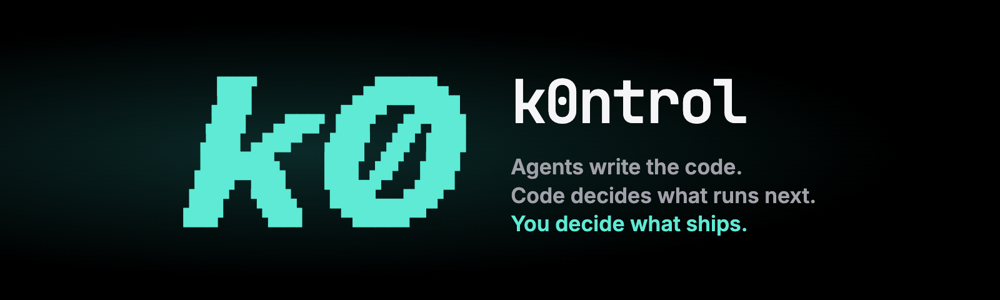
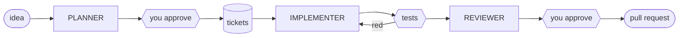

<p align="center">
  
</p>

<p align="center">
  <a href="https://github.com/rubjpDev/k0ntrol/actions/workflows/test.yml"></a>
  <a href="https://pypi.org/project/k0ntrol-cli/"></a>
  
  <a href="https://github.com/rubjpDev/k0ntrol/blob/main/LICENSE"></a>
</p>

**k0ntrol** (`k0`) is a local harness for coding agents. You plan the work with an agent. k0 builds it one ticket at a time, test-first, and reviews it twice. You decide what merges.

```text
› /implement #42
  IMPLEMENTER   slice 1  failing test       red
  IMPLEMENTER   slice 1  code               green
  VALIDATOR     tests ✓  gates ✓
  REVIEWER      conventions ✓  contract ✓
  Mark the pull request ready?
```
<sub>A condensed run.</sub>

## Quick start

```sh
uv tool install "k0ntrol-cli[openai]"
```

`pipx install "k0ntrol-cli[openai]"` works too.

Then, inside the repository you want to work on:

```sh
k0 init . --tracker github
k0
```

On the first run, k0 asks which models to use and saves your key. `k0 doctor` checks the setup at any time.

## Why k0

- **Code routes the work.** A LangGraph workflow graph decides which agent runs next.
- **Tests come first, enforced.** IMPLEMENTER can't write code until a test fails.
- **Gates are code or you.** Tests and linters decide green. You approve specs, tickets and the final review.
- **k0 never merges.** It opens the pull request and leaves the merge to you.

## How it works



PLANNER turns an idea into a spec and small tickets through a short Q&A. IMPLEMENTER builds each ticket in red-to-green slices. REVIEWER checks that the change follows the repo's conventions and does what the ticket asked.

## Commands

| Command | What it does |
| --- | --- |
| `/plan <idea>` | Q&A, then a spec and tickets on GitHub |
| `/research <question>` | Maps the open decisions and answers them with sources |
| `/implement #<ticket>` | Builds a ticket into a reviewed pull request |
| `/implement <task>` | Builds a small task in your working tree |
| `/triage #<issue>` | Labels a raw issue and makes it ready to build |
| `/ask <question>` | Asks about the repo |
| `/klog` | Opens a report of your runs and their cost |

`Shift+Tab` switches between Chat, Plan and Implement. `/help` lists everything.

## Providers

OpenAI by default. Anthropic, Amazon Bedrock, Ollama, OpenRouter and Google Vertex work too. Install the matching extra (`openai`, `anthropic`, `aws`, `ollama`, `openrouter`, `google`), and pick a model per agent in setup.

## Proof

The 0.1.0 release ran live end to end. k0 fixed a bug in its own repo and wrote 100% of [PR #198](https://github.com/rubjpDev/k0ntrol/pull/198). The whole check cost about €0.20 in model calls. See the [release evidence](https://github.com/rubjpDev/k0ntrol/blob/main/docs/releases/0.1.0.md).

## Learn more

- [GLOSSARY.md](https://github.com/rubjpDev/k0ntrol/blob/main/GLOSSARY.md): the workflow's terms
- [docs/adr](https://github.com/rubjpDev/k0ntrol/tree/main/docs/adr): every design decision and why it was made
- [CHANGELOG.md](https://github.com/rubjpDev/k0ntrol/blob/main/CHANGELOG.md): what changed in each release

Agent-written code runs on your machine, with no OS sandbox. k0 strips secrets from the test environment, guards file paths, and holds back any push that touches `.github/` ([ADR 0006](https://github.com/rubjpDev/k0ntrol/blob/main/docs/adr/0006-tool-safety-is-process-hygiene-and-code-guards-not-a-sandbox.md)).

## Make it yours

k0 is open source under Apache-2.0. Try it, fork it, make it your own, and extend it however you like. Add a provider, a tracker or a new agent, or bend the workflow to your team. Keep the license notice when you share your version.

## Contributing

Pull requests are welcome. Start from an issue and work test-first. A change is done when `./scripts/check` passes. The rules are in [AGENTS.md](https://github.com/rubjpDev/k0ntrol/blob/main/AGENTS.md). To work on k0 itself, install it from a clone:

```sh
git clone https://github.com/rubjpDev/k0ntrol && cd k0ntrol
uv tool install --editable ".[openai]"
```

## License

[Apache-2.0](https://github.com/rubjpDev/k0ntrol/blob/main/LICENSE)
